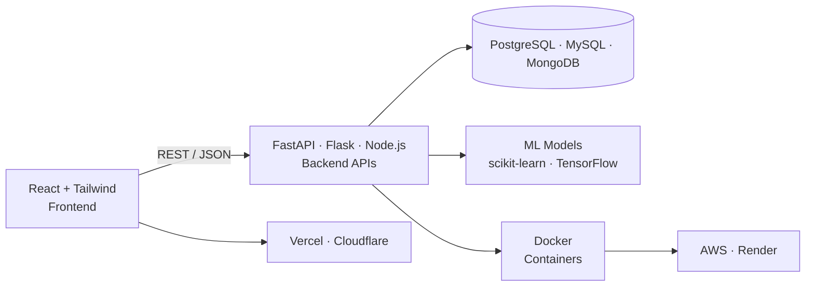

<div align="center">


<a href="https://git.io/typing-svg">
  
</a>

<br/>

[](https://hits.sh/github.com/ranjith-devaraj/ranjith-devaraj/)
[](https://github.com/ranjith-devaraj)
[](#-lets-connect)

</div>

---

## 👨‍💻 About Me

I'm a final-year **B.Tech (AI & Data Science)** student at **Erode Sengunthar Engineering College (2023–2027)** and a **Python Full Stack Developer Intern at 7s IQ Pvt Ltd**. I build end-to-end products — from REST APIs and databases to polished React frontends — and containerize and deploy them to the cloud.

```python
class Ranjith:
    role      = "Full Stack Developer (Python) & ML Enthusiast"
    education = "B.Tech AI & Data Science, 2023–2027"
    intern_at = "7s IQ Pvt Ltd"
    stack     = ["Python", "FastAPI", "Flask", "React", "Node.js", "Docker"]
    cloud     = ["AWS", "Vercel", "Render", "Cloudflare"]
    focus     = ["Backend Engineering", "REST APIs", "ML Engineering", "Clean UI"]
    looking_for = "Software development roles & internships (Fresher)"
```

- 🚀 Building production-style full-stack apps with clean architecture
- 🤖 Exploring ML engineering: training, evaluating and serving models via APIs
- ☁️ Learning cloud-native deployment, CI/CD and containerization
- 🎯 Seeking **entry-level / fresher** opportunities as a Python Full Stack Developer

---

## 🛠️ Tech Stack

<div align="center">

### 💻 Languages


### 🎨 Frontend


### ⚙️ Backend & APIs


### 🗄️ Databases


### 🤖 AI / ML Engineering


### ☁️ DevOps, Cloud & Deployment


### 🧰 Tools


</div>

---

## 🏗️ How I Build & Ship



| Layer | What I use |
|---|---|
| **Frontend** | React, Tailwind CSS, deployed on **Vercel** / **Cloudflare** |
| **Backend** | FastAPI, Flask, Node.js/Express with REST design & JWT auth |
| **Data** | PostgreSQL, MySQL, MongoDB, SQLite |
| **ML Serving** | Models trained in scikit-learn/TensorFlow, exposed through FastAPI endpoints |
| **Packaging** | Docker & Docker Compose |
| **Hosting** | AWS, Render, Vercel, Cloudflare (DNS / CDN) |

---

## 🚀 Featured Projects

<table>
  <tr>
    <td width="50%" valign="top">

### 🤖 AI-Powered Resume Screening
Matches resumes against job requirements using NLP and ML so recruiters can shortlist candidates faster.

**Stack:** `Python` `Flask` `scikit-learn` `NLP`

[](https://github.com/ranjith-devaraj/AI-powered-Resume-Screening)

  </td>
    <td width="50%" valign="top">

### 🧩 CRM Management System
Full-stack CRM for managing customers, leads and sales workflows with a clean dashboard.

**Stack:** `React` `REST API` `Python` `SQL`

[](https://github.com/ranjith-devaraj/crm-management-system)

  </td>
  </tr>
  <tr>
    <td width="50%" valign="top">

### 📍 Staff Attendance System
Attendance tracking with browser-based geolocation checks and email OTP verification.

**Stack:** `Python` `Flask` `Geolocation API` `SMTP`

[](https://github.com/ranjith-devaraj/staff_attendance_system)

  </td>
    <td width="50%" valign="top">

### 🛒 E-Commerce Website
Responsive online store with product listing, cart flow and a clean shopping experience.

**Stack:** `HTML` `CSS` `JavaScript` `React`

[](https://github.com/ranjith-devaraj/E-Commerce-Website)

  </td>
  </tr>
</table>

---

## 💼 Experience

**Python Full Stack Developer Intern** — *7s IQ Pvt Ltd*
Worked on full-stack features using Python backends and modern frontends, building and consuming REST APIs.

---

## 🎯 Currently Leveling Up

- 🐳 Docker & multi-stage builds for production images
- ☁️ AWS fundamentals (EC2, S3, IAM) and CI/CD with GitHub Actions
- ⚡ Advanced FastAPI: async, dependency injection, background tasks
- 🧠 ML engineering: model packaging, evaluation and serving

---

## 📊 GitHub Stats

<div align="center">


<br/>


</div>

### 🐍 Contribution Activity

<div align="center">


</div>

---

## 🤝 Let's Connect

<div align="center">

[](https://github.com/ranjith-devaraj/ranjith-devaraj/)
[](https://www.linkedin.com/in/ranjith-devaraj-python-full-stack-developer/)
[](mailto:YOUR-EMAIL@example.com)
[](https://YOUR-PORTFOLIO.vercel.app)

<br/>

*"Build. Learn. Ship. Repeat."* 🚀


</div>
